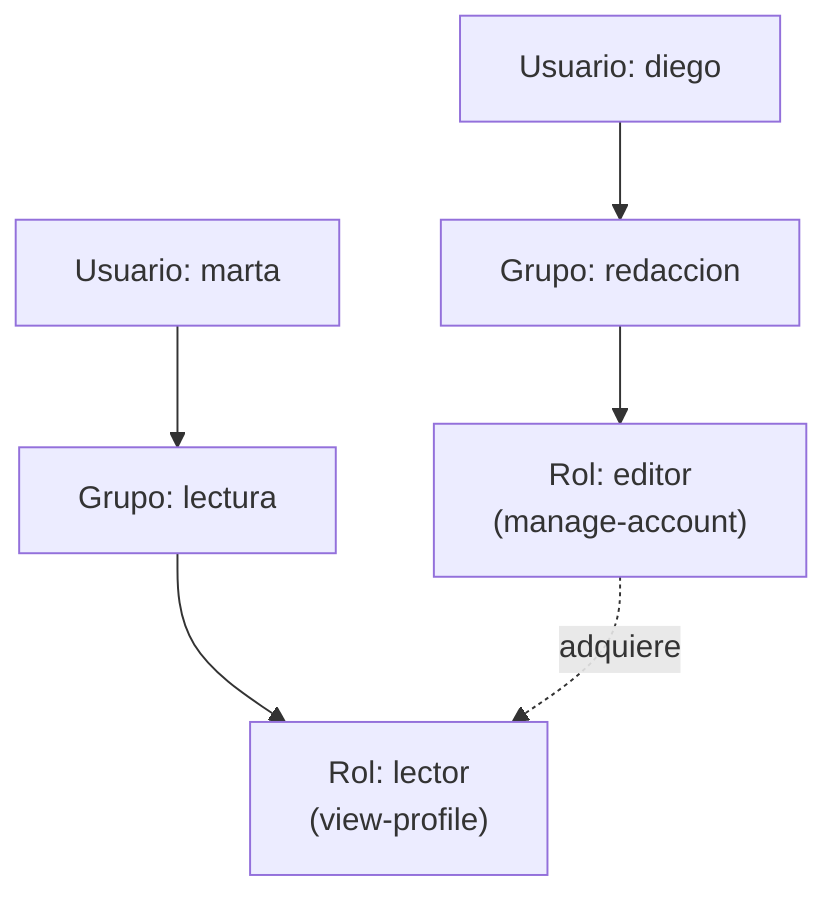

<br/><br/>


# Laboratorio 1: Identidad, realms y control de acceso basado en roles

*Curso de Identidad Digital, Autenticación y Autorización — Módulo 1: Arquitectura de Confianza Cero
y gobierno del ciclo de vida.*

## Objetivos

En las arquitecturas de software modernas, la identidad ha pasado a ser el plano de control
primario: ya no basta con estar "dentro de la red" para tener acceso a nada, sino que cada petición
debe autorizarse en función de quién la realiza y de qué se le permite hacer. Esta práctica
constituye el primer contacto con esa idea de forma tangible. En lugar de estudiar el control de
acceso en abstracto, se levanta un servidor de identidad profesional —**Keycloak**— y se modela
dentro de él una pequeña organización, observando directamente cómo se conceden, se heredan y se
retiran los permisos.

Al finalizar la práctica, el estudiante será capaz de:

- Comprender qué es un *realm* y por qué constituye una frontera de aislamiento entre identidades.
- Diseñar un esquema de control de acceso basado en roles (**RBAC**), incluyendo roles compuestos y
  herencia entre ellos.
- Distinguir la asignación de permisos por usuario de la asignación por grupo, y justificar por qué
  la segunda evita la acumulación descontrolada de privilegios.
- Interpretar el contenido de un *token* de acceso y relacionar lo que este afirma con la
  configuración del servidor.

## Dependencias

Para realizar la práctica, el alumno deberá tener instalado en su ordenador:

- **Docker** y **Docker Compose** ([instalación](https://docs.docker.com/get-docker/)).
- Los puertos **8080** y **9000** libres.

No se requieren conocimientos de programación: en toda la práctica no se escribe una sola línea de
código. El trabajo consiste en configurar el servidor a través de su consola de administración y en
razonar sobre el efecto de cada acción.

## Descripción de la práctica

La práctica simula la gestión de identidades de una pequeña redacción editorial. En esa
organización conviven dos tipos de personas: quienes solo necesitan **consultar** la información y
quienes además deben poder **editarla**. Esta distinción, aparentemente trivial, es el germen de
todo sistema de autorización: hay que decidir quién puede hacer qué, y hay que poder cambiarlo con
rapidez cuando alguien cambia de puesto o abandona la organización.

El servidor que da soporte a este escenario es **Keycloak**, una solución de gestión de identidad y
acceso de código abierto ampliamente utilizada en la industria. Keycloak organiza todo lo que
gestiona dentro de *realms*. Un **realm** es un espacio de identidad completamente independiente:
los usuarios, roles y aplicaciones de un realm no existen en ningún otro. El realm que Keycloak
utiliza para administrarse a sí mismo se llama `master`; para la organización de la práctica se
creará un realm propio, `curso`, de modo que ambos queden aislados.

Dentro del realm se construirá un modelo de **control de acceso basado en roles (RBAC)**. En RBAC
los permisos no se conceden directamente a las personas, sino a **roles** (como `lector` o
`editor`), y las personas obtienen esos permisos al recibir el rol. Para que el modelo sea más
mantenible, los roles se asignarán además a través de **grupos**: un usuario entra en un grupo y
hereda los roles de ese grupo. Finalmente, se establecerá una relación de herencia entre roles —el
rol `editor` será también un `lector`— para no tener que repetir permisos. El modelo completo que se
va a construir es el siguiente:



Como cierre, y en lo que será un hilo conductor de todo el curso, no nos conformaremos con ver que
una pantalla "funciona o no funciona": abriremos el **token** que Keycloak emite para cada usuario y
comprobaremos que lo que el token afirma sobre sus permisos coincide exactamente con lo que se ha
configurado. El token es la evidencia última de que el modelo es correcto.

---

## 1. Puesta en marcha del entorno

El primer paso es levantar el servidor. El fichero `docker-compose.yml` que acompaña a la práctica
arranca Keycloak en modo de desarrollo (`start-dev`), adecuado para aprendizaje pero no para
producción. Para iniciarlo, copie el fichero de configuración y levante el contenedor:

```bash
cp .env.example .env
docker compose up -d
```

El arranque no es instantáneo: Keycloak necesita inicializar su base de datos interna. Espere a que
la columna de estado indique `healthy` antes de continuar:

```bash
docker compose ps
```

Una vez operativo, abra `http://localhost:8080/` y acceda a la **Administration Console** con las
credenciales definidas en `.env` (`admin` / `admin` por defecto). En la entrada "Manage realms", el realm `master` sera el que aparezca activo: es el realm de administración del propio Keycloak, y conviene tenerlo presente porque se retomará al final de la práctica.

> **Pregunta 1.1.** Al acceder, Keycloak advierte: "you are logged in as a temporary admin user". ¿Por
> qué califica esa cuenta de *temporary*?

---

## 2. Modelado de los roles

Con el servidor en marcha, se construye el esqueleto del modelo de acceso. Conviene aquí una
precisión conceptual: Keycloak distingue entre **roles de realm** y **roles de cliente**. Un rol de
realm es un concepto de negocio que define la propia organización (`lector`, `editor`) y no depende
de ninguna aplicación concreta. Un rol de cliente, en cambio, es un permiso que define una
aplicación específica; en esta práctica se usará el cliente interno `account` (el portal de cuenta
del usuario), que ofrece permisos como `view-profile` (ver el perfil) y `manage-account`
(gestionarlo). El modelo consistirá en conectar los roles de negocio con esos permisos concretos.

Realice los siguientes pasos:

1. **Crear el realm:** despliegue `master` (sup. izq.) → **Create realm** → nombre `curso` → Create.
2. **Crear los roles de negocio:** menú **Realm roles** → Create role → `lector` → Save. Repita con
   `editor`.
3. **Vaciar el conjunto de permisos por defecto:** por comodidad, Keycloak concede a todo usuario
   nuevo unos permisos básicos sobre su propia cuenta. Para que en esta práctica *todo* permiso sea
   explícito, se retiran: **Realm settings** → pestaña **User registration** → **Default roles** (con
   "Hide inherited roles" marcado) → seleccione `account / manage-account` **y** `account /
   view-profile` → **Unassign**. A partir de aquí, un usuario sin rol no puede ni ver su perfil.
4. **Definir `lector` como "puede ver":** abra el rol `lector` → pestaña **Associated roles** →
   Assign role → filtre por roles de cliente → `account` → marque `view-profile` → Assign.
5. **Definir `editor` como "lector que además edita":** abra `editor` → **Associated roles** →
   Assign role → busque el rol de **realm** `lector` → Assign; a continuación, Assign role de nuevo,
   esta vez filtrando por cliente `account` → marque `manage-account` → Assign.

El paso 5 es el más interesante del apartado. Un rol que contiene a otros se denomina **rol
compuesto**, y al asociar `editor` con `lector` se está declarando de forma explícita que "todo
editor es también un lector". Esta relación no es un mero atajo: expresa una jerarquía real.

> **Pregunta 2.1.** ¿Por qué se asocia `editor` con el rol `lector`, en lugar de añadirle directamente el
> permiso `view-profile` que `lector` ya tiene?

Antes de crear a las personas, queda un último ajuste en el realm. Un modelo de acceso no solo debe
decidir quién puede hacer qué: también debe dejar constancia de lo que ocurre, para poder responder
más adelante a preguntas como *quién entró*, *cuándo* o *quién cambió un permiso*. Es lo que se
conoce como **trazabilidad** (*accountability*). Keycloak la ofrece mediante el registro de
**eventos**, que viene desactivado por defecto y solo registra lo que ocurra a partir del momento en
que se activa; por eso conviene hacerlo ahora.

1. **Eventos de usuario:** **Realm settings** → pestaña **Events** → sub-pestaña **User events
   settings** → active **Save events** → **Save**. Quedan registrados los inicios de sesión, los
   errores de acceso, los cambios de perfil, etc.
2. **Eventos de administración:** sub-pestaña **Admin events settings** → active **Save events** y
   también **Include representation** → **Save**. Quedan registrados los cambios que se hagan desde
   la consola de administración, junto con el detalle de lo que se cambió.

---

## 3. Usuarios, grupos y herencia de permisos

Definidos los roles, faltan las personas. Aquí se introduce una decisión de diseño fundamental:
**los roles no se asignarán directamente a los usuarios, sino a grupos**, y los usuarios se
incorporarán a esos grupos. La diferencia parece menor con dos usuarios, pero es exactamente la que
previene uno de los problemas clásicos de la gestión de identidad: el *privilege creep*, la
acumulación lenta e invisible de permisos que nadie recuerda haber concedido. Cuando los permisos
viven en los grupos, el acceso de una persona se entiende de un vistazo —por los grupos a los que
pertenece— y se modifica en un solo lugar.

Realice los siguientes pasos:

1. **Crear usuarios:** menú **Users** → Add user → `marta` → Create. Repita con `diego`.
2. **Asignar contraseña:** en cada usuario, pestaña **Credentials** → Set password → **desactive el
   conmutador Temporary** → Save.
3. **Crear grupos:** menú **Groups** → Create group → `lectura` → Create. Repita con `redaccion`.
4. **Asignar el rol a cada grupo:** `lectura` → **Role mapping** → Assign role → `lector` → Assign;
   `redaccion` → **Role mapping** → Assign role → `editor` → Assign.
5. **Incorporar cada usuario a su grupo:** Users → `marta` → **Groups** → Join group → `lectura`;
   Users → `diego` → **Groups** → Join group → `redaccion`.
6. **Verificar la herencia:** Users → `diego` → **Role mapping** → **desactive** "Hide inherited
   roles". Debe figurar `editor`, marcado como heredado de `redaccion`. Repita con `marta`:
   figurará `lector`, heredado de `lectura`. Ninguno de los dos tiene rol asignado de forma directa.

Antes de continuar, conviene detenerse un momento en la contraseña que se acaba de asignar. En la
pestaña **Credentials** de cualquiera de los dos usuarios, la opción **Show data** muestra cómo la
ha almacenado Keycloak: un algoritmo (`argon2`, en su variante `id`) acompañado de varios parámetros
(`memory`, `hashIterations`, `parallelism`). Lo que no muestra en ningún caso es la contraseña, ni
tampoco su *hash* completo.

> **Pregunta 3.1.** ¿Qué aportan esos parámetros a la seguridad del almacenamiento de la contraseña? ¿Y
> por qué ni siquiera el administrador del realm puede consultar la contraseña de un usuario?

Para comprobar que el modelo tiene consecuencias reales, abra una **ventana privada** y acceda al
portal de cuenta del usuario en `http://localhost:8080/realms/curso/account/`. Inicie sesión como
`diego`, modifique un campo del perfil (por ejemplo, el nombre) y guarde: la operación se completa,
porque `diego` posee `manage-account` a través de su rol `editor`.

> **Advertencia.** No debe repetirse la prueba anterior con Marta. Con únicamente `view-profile` (sin
> `manage-account`), la consola de cuenta de esta versión de Keycloak no se degrada a un modo de solo
> lectura: directamente no carga y muestra una pantalla de error. No se trata de un fallo de
> configuración, sino de una limitación conocida de esta versión. El permiso de Marta se comprobará
> en el apartado 4 mediante el token; y en el apartado 5 se reproducirá esta misma situación de forma
> deliberada, para entender a qué se debe.

> **Pregunta 3.2.** ¿Qué ventaja concreta aporta este modelo si `redaccion` tuviera 200 personas en lugar
> de una?

---

## 4. Lectura del token de acceso

Hasta ahora, la autorización se ha comprobado observando si una pantalla permitía o no una acción.
Ese método es frágil y, como se ha visto con Marta, a veces engañoso. El método fiable consiste en
examinar el **token**: cuando un usuario accede a una aplicación, Keycloak emite un token que
contiene, entre otras cosas, la lista de permisos efectivos de ese usuario. Keycloak ofrece una
herramienta para generar ese token sin necesidad de iniciar sesión, lo que permite inspeccionarlo
cómodamente.

1. Menú **Clients** → `account` → pestaña **Client scopes** → sub-pestaña **Evaluate**.
2. Seleccione el usuario `diego` → genere el token → localice en el JSON el campo
   `resource_access.account.roles`: figura **`manage-account`**.
3. Repita con `marta`: en su token, ese mismo campo contiene únicamente **`view-profile`**;
   `manage-account` no aparece.

La diferencia entre ambos usuarios, que la pantalla de Marta no dejaba apreciar, aquí es inequívoca y
está escrita en el propio token. Esta es la idea que se repetirá a lo largo del curso: la verdad
sobre los permisos no está en la interfaz, está en el token.

A continuación, una última observación sobre el aislamiento. Vuelva a la consola de administración,
cambie el desplegable de `curso` a `master` y abra **Users**. Ni Marta ni Diego aparecen.

> **Pregunta 4.1.** ¿Por qué un usuario creado en el realm `curso` no existe en el realm `master`?

---

## 5. Verificación del modelo: retirar un permiso

Un modelo de acceso no solo debe conceder permisos correctamente, sino también retirarlos con
limpieza. En este apartado se comprueba el efecto en cascada de un cambio hecho sobre el grupo, sin
tocar al usuario.

1. En el realm `curso` → **Groups** → `redaccion` → **Role mapping** → retire (Unassign) el rol
   `editor`. En ningún momento se modifica al usuario Diego.
2. En la pestaña donde Diego mantiene abierta su consola de cuenta, actualice la página (no es
   necesario volver a iniciar sesión: el token se renueva a partir de la sesión activa). La consola
   dejará de cargar y mostrará una pantalla de error. El motivo merece razonarse: al retirar el rol
   **compuesto** `editor`, Diego no pierde únicamente `manage-account`, sino *todos* sus permisos,
   incluido `view-profile` —que le llegaba precisamente a través de la cadena `editor` → `lector`—.
   Se queda, por tanto, sin ningún rol. Retirar un rol compuesto arrastra consigo toda la jerarquía
   que colgaba de él.
3. Intente ahora acceder a la consola de cuenta como **Marta** —la comprobación que el apartado 3
   había dejado pendiente—, en `http://localhost:8080/realms/curso/account/`. El inicio de sesión se
   completa, pero la consola no llega a cargar: se produce la misma pantalla de error que acaba de
   observarse con Diego.

   > **Nota.** Este comportamiento no es un error de configuración, sino una particularidad de cómo
   > está construido Keycloak. Marta posee `view-profile`, esto es, permiso para *ver* su perfil; sin
   > embargo, esta versión de la consola de cuenta (la v3) exige `manage-account` para arrancar
   > siquiera. Al no disponer de él, no ofrece una versión de solo lectura: sencillamente no carga (un
   > error 401 en segundo plano). El modelo de permisos de Marta es correcto; es la interfaz la que no
   > sabe degradarse con elegancia ante la ausencia de ese permiso. De ahí la idea que recorre toda la
   > práctica: para saber qué puede hacer realmente cada usuario no debe observarse la pantalla, sino
   > el token.
4. Compruébese precisamente eso. Repita la evaluación del apartado 4 para `diego`: en
   `resource_access.account.roles` ya no figura `manage-account` (tampoco `view-profile`). El cambio
   efectuado sobre el grupo se ha propagado hasta el token de Diego sin haberle modificado a él en
   ningún momento.

El permiso de Diego ha cambiado sin que se le haya tocado a él directamente, y ha bastado con
actualizar la página para que el cambio surta efecto. Esto revela algo importante sobre cómo
funcionan los tokens.

> **Pregunta 5.1.** Diego pierde la capacidad de editar con solo actualizar la página, sin cerrar ni
> volver a abrir sesión. ¿Cómo es posible?

Queda una última comprobación. Si mañana alguien preguntara *quién* retiró el permiso de edición y
*cuándo*, ni la pantalla ni el token sabrían responder. Para eso se activó el registro de eventos en
el apartado 2.

1. Menú **Events** → pestaña **Admin events**. La entrada más reciente corresponde a la retirada del
   rol: tipo de recurso `REALM_ROLE_MAPPING`, operación `DELETE`, sobre una ruta que empieza por
   `groups/`. En el menú de la fila (**⋮**) → **Representation** se ve qué rol se retiró.
2. Pestaña **User events**: figuran los inicios de sesión de Diego y de Marta (`LOGIN`) y, si alguien
   se equivocó de contraseña, también los intentos fallidos (`LOGIN_ERROR`), con la fecha y la
   dirección IP.

> **Pregunta 5.2.** ¿Qué información aporta el registro de eventos que no aportaba el token? En la
> entrada de la retirada del rol, la columna **User** no muestra un nombre, sino un identificador:
> ¿de quién es, y por qué no aparece entre los usuarios del realm `curso`?

---

## 6. Un permiso nuevo: el borrado de cuenta

Para consolidar el modelo, se añade un permiso más siguiendo el mismo patrón de los apartados
anteriores. La organización necesita que algunas personas puedan **darse de baja ellas mismas**,
borrando su propia cuenta desde el portal de cuenta. Ese permiso existe en Keycloak como rol de
cliente: `account` → `delete-account`.

1. Siguiendo el mismo modelo del apartado 3, cree un rol de negocio `baja` que contenga ese permiso,
   un grupo que lo conceda y un usuario nuevo incorporado a ese grupo. El usuario debe poder abrir su
   consola de cuenta (recuerde lo que ocurrió con Marta).
2. Compruebe en el token (apartado 4) que el usuario recibe efectivamente `delete-account`.
3. Acceda a la consola de cuenta de ese usuario. ¿Aparece la opción de borrar la cuenta? Si no
   aparece, averigüe por qué, si el rol está bien configurado y el token lo demuestra, y consiga que
   aparezca.
4. Borre la cuenta desde el propio portal y compruebe en la consola de administración que el usuario
   ya no existe.

> **Pista** (consúltela solo si se atasca en el punto 3).
>
> <details><summary>Ver pista</summary>
> En Keycloak, un rol concede un <em>permiso</em>, pero algunas acciones requieren además que la
> funcionalidad esté activada en el realm como <em>required action</em>. Busque en
> <strong>Authentication</strong>. Rol y <em>required action</em> son dos mecanismos distintos que
> deben coincidir.
> </details>

Con este apartado, el modelo reúne ya usuarios cuyos permisos llegan por caminos distintos: grupos
diferentes, roles compuestos y roles de cliente. Cabe preguntarse, entonces, qué ocurre cuando esos
caminos parecen no estar de acuerdo.

> **Pregunta 6.1.** Supóngase que una persona pertenece a dos grupos cuyos roles parecen contradecirse:
> uno le concede un permiso y el otro, en principio, debería negárselo. ¿Qué permisos efectivos
> tendría en Keycloak, y por qué?

---

## Resolución de problemas

- No aparecen los usuarios o roles creados → probablemente el desplegable muestra `master` en lugar
  de `curso`. Selecciónelo de nuevo.
- El contenedor tarda en alcanzar el estado `healthy` → es normal en el primer arranque; espere
  30-40 segundos.
- La consola de cuenta de un usuario queda atascada en una pantalla de error (el usuario carece de
  `manage-account` pero conserva una sesión y un token activos) → se recupera de dos formas: (a)
  restaurar el permiso, volviendo a asignar el rol correspondiente —en esta práctica, `editor` al
  grupo `redaccion`—, con lo que el siguiente token vuelve a incluir `manage-account` y la consola
  carga de nuevo; o (b) cerrar la sesión del usuario desde la consola de administración, en **Users**
  → el usuario → pestaña **Sessions** → **Sign out**, lo que invalida la sesión activa y obliga a
  emitir un token nuevo en el próximo acceso.
- El menú **Events** aparece vacío → el registro de eventos solo guarda lo ocurrido desde que se
  activa. Compruebe que **Save events** está activado en las dos sub-pestañas del apartado 2 y
  repita alguna acción (por ejemplo, un inicio de sesión).
- Para reiniciar el entorno desde cero (se elimina el realm, los usuarios y los roles):
  `docker compose down -v && docker compose up -d`.
